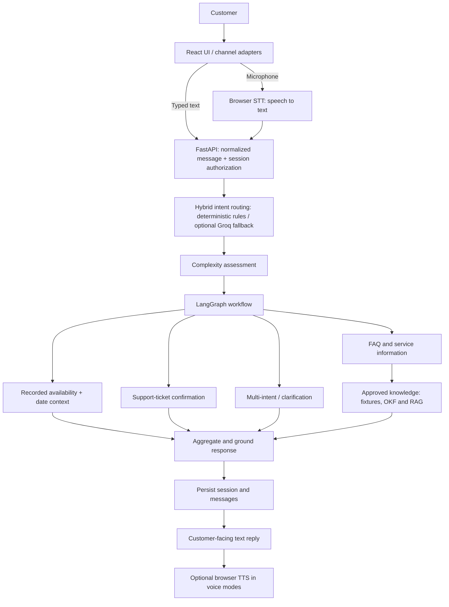

# AI Customer Calling Agent — TECHOHUB

**A browser-based, multi-agent customer-service assistant for a demo salon.** Customers can ask about haircut and beard-trim services, prices, durations, business hours, and sample appointment availability; they can also request a follow-up from staff through a confirmation-based support ticket.

**[Try the live demo](https://techohub-ai-customer-calling-agent-git-deployment-75e2ae-yoink6.vercel.app)** · **[Explore the architecture](docs/03_SYSTEM_ARCHITECTURE.md)** · **[Browse the documentation](docs/00_MASTER_INDEX.md)**

> **Demo scope:** This is a deployed **browser-based** assistant, not a telephone-network calling service. It uses approved fictional salon data and recorded sample appointment slots. It **does not** make real bookings, connect callers to live staff, or place outbound telephone calls. Voice recognition depends on browser support and microphone permissions.

## What the assistant can do

| Capability | What it demonstrates |
| --- | --- |
| **Text and browser voice** | Message Mode, Mic Mode, and browser-based call experiences; speech recognition converts voice to text, and supported voice modes can speak responses. |
| **Grounded service answers** | Answers about catalog services, prices, durations, and opening hours using approved salon information rather than invented facts. |
| **Sample appointment availability** | Reads **recorded fixture slots**, clearly distinguished from live calendar availability; supports contextual date correction. |
| **Multiple intents** | Routes compound customer questions through a multi-intent workflow and aggregates supported results. Complex queries may still require clarification or omit a sub-question. |
| **Human follow-up requests** | Offers a support ticket when someone asks for staff, creates it only after explicit confirmation, and returns a ticket ID. |
| **Persistent sessions** | Stores conversation/session records and queued tickets; deployed Preview uses Neon PostgreSQL, while local development uses SQLite. |
| **Security boundaries** | Session-scoped access tokens, protected staff APIs, server-side secrets, and no unsupported claims of completed real-world actions. |

### Example questions

- “How much is a haircut?”
- “How long does a beard trim take?”
- “Are you open on Saturday?”
- “What sample appointment slots are available?”
- “I want to talk to a human.” → **“Create a ticket.”**

## How it works



**The key design idea:** Channel adapters give the backend a consistent text-message interface. A **rules-first intent classifier**, with optional LLM classification for unresolved cases, identifies the request; a separate complexity decision helps choose the workflow. **LangGraph** coordinates specialist capabilities and response aggregation. **OKF** (Open Knowledge Format) and **RAG** (Retrieval-Augmented Generation) help ground factual answers in approved business information. Selected capabilities can be reached through **direct tool calls or MCP (Model Context Protocol)** interfaces; MCP is the tool interface, not a separate model. The final response is saved and returned as text, with optional browser text-to-speech.

**Knowledge safety:** Canonical approved fixtures take precedence when they conflict with other retrieved knowledge. Unsupported answers should be declined or clarified rather than invented.

For implementation details, see the [architecture document](docs/03_SYSTEM_ARCHITECTURE.md) and the **“View how TECHOHUB works”** page in the running frontend.

## Technology stack

| Layer | Technologies / responsibility |
| --- | --- |
| Frontend | **React, JavaScript, Vite** — user interface, channel controls, browser STT/TTS integration |
| Backend | **Python, FastAPI, Pydantic** — REST endpoints, validation, session lifecycle |
| Agent workflow | **LangGraph** — conditional routing, specialist workflow nodes, state and response aggregation |
| Model integration | **Groq** — optional LLM-backed intent classification / supported agent processing |
| Knowledge and tools | **OKF, RAG, MCP**, approved fixtures, direct application capabilities |
| Persistence | **SQLAlchemy, SQLite** (local), **Neon PostgreSQL** (deployed Preview) |
| Deployment and tests | **Vercel** frontend/backend, **pytest**, frontend test/build tooling |

## Live deployment

**Frontend (stable Preview):**

https://techohub-ai-customer-calling-agent-git-deployment-75e2ae-yoink6.vercel.app

The deployed **Preview** pair was tested end to end: frontend access, backend health, CORS preflight, authenticated session creation, message persistence, and a grounded haircut-price response. That verification does **not** guarantee every voice mode, browser, or complex query will behave identically.

The deployed configuration uses separate Vercel frontend and FastAPI projects, with branch-scoped environment variables and an isolated Neon Preview database. Preview-domain access and Vercel Deployment Protection must be configured together so browser requests can reach the backend; **Production and Preview are different environments**.

See [Free deployment guide](docs/17_FREE_DEPLOYMENT_GUIDE.md) for setup considerations. Do not copy production credentials into frontend environment variables or check them into Git.

## Run locally

**Requirements:** Python **3.12**, Node.js/npm. Docker is not required.

### 1. Clone and install the backend

```powershell
git clone https://github.com/mhassansalman/techohub-ai-customer-calling-agent.git
cd techohub-ai-customer-calling-agent
py -3.12 -m venv .venv
.\.venv\Scripts\Activate.ps1
python -m pip install -r requirements.lock.txt
```

If PowerShell restricts activation, call `.\.venv\Scripts\python.exe` directly. In Git Bash, activate with `source .venv/Scripts/activate`.

### 2. Start the backend

```powershell
python -m uvicorn backend.main:app --reload --host 127.0.0.1 --port 8000
```

The local database defaults to ignored SQLite storage (`data/techohub.db`). The deterministic rule-based flows can run without a Groq key; optional LLM-backed behavior requires server-side `GROQ_API_KEY` configuration.

### 3. Start the frontend in a second terminal

```powershell
cd frontend
npm.cmd ci
npm.cmd run dev
```

Open the local Vite URL (typically `http://127.0.0.1:5173`). The development proxy forwards `/api` requests to the backend on `127.0.0.1:8000`.

The exact latest deployment configuration lives in the separate deployment branch, **`deployment/vercel-from-local-recovery`**. This README documents the public repository and previously verified Preview architecture; if running `main`, treat its code and configuration as authoritative for that checkout rather than assuming branch parity.

### 4. Check the project

```powershell
# From the repository root, with the virtual environment active
python -m pytest

# From frontend/
npm.cmd test
npm.cmd run build
```

## API overview

| Endpoint | Purpose |
| --- | --- |
| `POST /api/sessions` | Create a session and record automated-assistant disclosure. |
| `POST /api/sessions/{session_id}/messages` | Submit a normalized message, run the LangGraph workflow, and store the grounded response. |
| `GET /api/sessions/{session_id}` | Read authorized session status and record counts, not a public transcript dump. |
| `POST /api/sessions/{session_id}/end` | Close an active session with a documented outcome. |
| `GET /api/staff/tickets?limit=50` | List queued support tickets for authorized staff (max 100). |
| `GET /api/staff/tickets/{ticket_id}` | Retrieve one ticket for authorized staff. |

Session-specific requests use an **`X-Session-Token`**. Staff ticket routes require a separately configured server-side **`STAFF_API_KEY`**, supplied in the **`X-Staff-API-Key`** header; those endpoints fail closed without the key. Never expose staff or LLM credentials to the browser.

### Knowledge and routing details

- **`backend.intent.RuleFirstIntentClassifier`** applies deterministic classification and invokes the Groq adapter only when classification cannot be safely established locally. Its outputs are validated rather than blindly trusted.
- **`backend.workflow.ConversationWorkflow`** uses LangGraph to route service/FAQ, availability, support, clarification, and multi-intent handling and assemble replies.
- **`backend.knowledge.KnowledgeService`** serves source-traceable facts from approved salon fixtures and eligible approved knowledge records.
- **`backend.availability.AvailabilityService`** exposes only recorded sample slots. Availability context can retain the selected service/date for follow-up corrections; it **never** modifies a real booking calendar.
- **Support-ticket creation** is a confirmed, recorded action, not a live transfer.

## Known limitations and safeguards

- **No real salon integrations:** no real booking writes, CRM updates, staff transfers, or outbound PSTN telephone calls.
- **Sample data only:** prices, opening hours, and slots are fictional approved demo information, not a public business directory.
- **Voice behavior varies:** browser speech recognition can fail on short utterances, noise, permissions, and network/browser support. Microphone audio is not stored by this app; recognized transcripts can be saved with the conversation.
- **Compound questions are not guaranteed:** some multi-intent duration questions may return only a subset of the requested facts.
- **Confirmed actions only:** ticket requests require confirmation; protected staff operations remain separate from customer conversation access.
- **Deployment-specific configuration:** CORS origins, Vercel protection exceptions, and frontend build-time API URLs must agree. Stable Preview aliases reduce URL churn but their public exception may also cover future deployments using those aliases.

## Project scope and development records

The engineering work was organized by priority: **P0** required scope, **P1** approved enhancements, and **P2** excluded features. The backlog and design documents record the assignment and implementation history, not a promise that excluded features have been completed.

- [V2 development plan](assignment/03_Revised_Development_Plan_v2.md)
- [V2 traceable backlog](assignment/04_Revised_Traceable_Backlog_v2.md)
- [Machine-readable task backlog](assignment/task_backlog_v2.json)

## Documentation

- [Documentation index](docs/00_MASTER_INDEX.md)
- [Project charter and scope](docs/01_PROJECT_CHARTER_AND_SCOPE.md)
- [System architecture](docs/03_SYSTEM_ARCHITECTURE.md)
- [Data model and database](docs/08_DATA_MODELS_AND_DATABASE.md)
- [Tech stack and deployment configuration](docs/10_TECH_STACK_DEPLOYMENT_AND_CONFIG.md)
- [Architecture decisions and open questions](docs/12_ARCHITECTURE_DECISIONS_AND_OPEN_QUESTIONS.md)
- [Implementation dependency order](docs/13_IMPLEMENTATION_SEQUENCE_AND_DEPENDENCIES.md)
- [Free deployment guide](docs/17_FREE_DEPLOYMENT_GUIDE.md)

## Demo video

*A short walkthrough video can be linked here once recorded.* A hosted video with a clickable screenshot/thumbnail works well for GitHub readers and nontechnical reviewers.

---

**TECHOHUB** is the company name; **AI Customer Calling Agent** is the project. This repository demonstrates a grounded, multi-capability **browser** assistant using a fictional salon scenario—not a real salon booking or telephone service.
